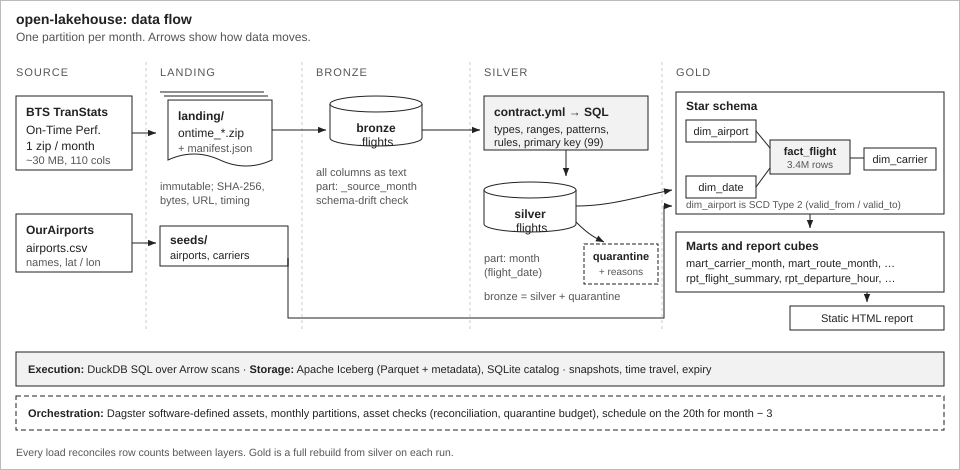
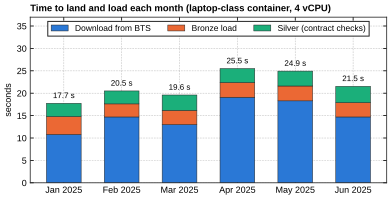
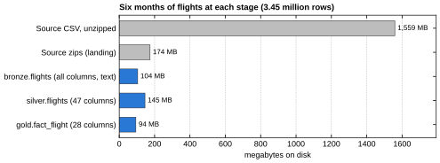

# open-lakehouse

At work I build medallion pipelines on Azure Databricks. This is the same pattern rebuilt from
open-source parts, so I could see how each piece actually works without a platform doing it for me:
Apache Iceberg tables, DuckDB for the SQL, Dagster for scheduling, and a YAML data contract that
drives the silver layer.

The data is public: every scheduled domestic flight reported to the Bureau of Transportation
Statistics (BTS). Six months of 2025 is 3.45 million rows. A full run, including downloading
175 MB of zipped CSV from BTS, took 2 minutes 16 seconds on a 4-vCPU container.

The report it produces: **https://sidantap.github.io/portfolio-redesign/lakehouse/**
(five pages with slicers: summary, carriers, airports and routes, delays, and data operations).



## Running it

```bash
uv sync
uv run lakehouse run --months 2025-01:2025-03     # ~85 MB download, about a minute
uv run lakehouse report --out site                # then open site/index.html
```

Or in Docker, with the Dagster UI on http://localhost:3000:

```bash
docker compose up
docker compose run --rm lakehouse lakehouse run --months 2025-01:2025-03
```

Everything is written under `./lakehouse_data` (set `LAKEHOUSE_HOME` to change it): the landed zip
files, the Iceberg warehouse (Parquet plus metadata) and a SQLite catalog file. Deleting the folder
resets everything.

Other commands: `lakehouse tables`, `lakehouse history <table>`, `lakehouse sql "<query>"`
(add `--at table=<snapshot_id>` to read a table as it was), `lakehouse quarantine` and
`lakehouse maintain --keep 5` to expire old snapshots.

## How it fits together

**Landing.** Each month's zip is downloaded once to a temporary name, checked, then renamed into
place, with a small JSON manifest beside it (URL, size, SHA-256, download time). Files in landing
are never modified.

**Bronze** (`bronze.flights`) is the CSV as it arrived: all 110 columns kept as text, plus the
source month, file name, row number, batch id and load time. It's partitioned by source month and
each load overwrites only its own month, so re-running a month doesn't duplicate anything. Bronze
refuses a file only if a column the contract needs has disappeared from the header. New columns are
fine: Iceberg adds them to the table (schema evolution) and older snapshots still read normally.

**Silver** (`silver.flights`) is typed and validated against
[`contracts/silver_flights.yml`](src/lakehouse/contracts/silver_flights.yml). That file lists every
silver column with its source column, type and limits, plus a handful of rules that span columns.
[`contract.py`](src/lakehouse/contract.py) turns it into a single DuckDB query that casts each column
and builds a list of the checks each row failed. Rows with an empty list go to silver; the rest go
to `silver.flights_quarantine` with that list and the original raw values. If more than 0.5% of a
month fails, nothing is written and the run stops.

**Gold** is a star schema (`fact_flight`, `dim_airport`, `dim_carrier`, `dim_date`), a few marts,
and three summary tables (`rpt_*`) that the report filters in the browser. The airport dimension
keeps history (SCD Type 2): if BTS changes an airport's code, city name or state, the old version
gets a `valid_to` date and flights join to whichever version was valid on their date. Airport names
and coordinates come from [OurAirports](https://ourairports.com/data/), via
[`scripts/build_airport_seed.py`](scripts/build_airport_seed.py).

**Ops.** Every stage of every run writes a row to `ops.load_audit`: start and finish time, rows in
and out, rows quarantined, status, and the error message if it failed. Iceberg snapshots say what
changed in a table; the audit table says how the run went.

Dagster ([`definitions.py`](src/lakehouse/definitions.py)) runs the same functions as assets with
one partition per month, shows the reconciliation and quarantine-budget results as asset checks,
and has a schedule that loads month M−3 on the 20th (BTS publishes about three months behind).

## The data contract, in practice

Real BTS data is clean. Across six months the contract rejected exactly one row out of 3,446,676:

| | |
|---|---|
| Flight | PSA Airlines 5292, Charlotte (CLT) to Knoxville (TYS), 30 March 2025 |
| Distance | 177 miles |
| Scheduled times | 22:49 departure, 23:59 arrival |
| `CRSElapsedTime` in the file | **1,510 minutes** (about 25 hours) |
| Check it failed | `max:crs_elapsed_min` (limit 1,440) |

It's probably a typo for 70 minutes, but I didn't want the pipeline guessing. The row is kept in
quarantine with its raw values, and everything downstream reconciles:
bronze rows = silver rows + quarantined rows, and fact rows = silver rows.

The tests use invented rows to cover the checks real data doesn't trigger, 16 different violations
in all, including cancelled flights with an arrival time, delay causes that don't add up to the
arrival delay, midnight written as `2400`, and duplicate keys.

## Numbers from one run

Six months, January to June 2025, on a 4-vCPU cloud container:



Downloading from BTS is most of the time: 11 to 19 seconds per month in this run, and up to
38 seconds in an earlier one, depending on the server. Bronze and silver each take a little over
3 seconds per month (about 600,000 rows), and rebuilding all of gold takes about 4 seconds. These
come from `ops.load_audit`.



The 1.56 GB of CSV is 104 MB as bronze Parquet, even with every column stored as text. Silver is
*larger* than bronze, which surprised me. Most of the difference is `flight_key`, a 16-character hash
I added as a surrogate key: random hex doesn't compress, and that one column is 32 MB, 22% of silver.
The natural key columns are already there, so I'd drop it, or compute it when needed, next time.

## Things that went wrong

- **DuckDB 2.0 changed under me.** The `x -> expr` lambda syntax is deprecated (now `lambda x: expr`)
  and `fetch_arrow_table()` was removed in favour of `to_arrow_table()`. I pinned `duckdb>=2.0,<3`.
- **PyIceberg partition transforms need an extra package.** Writing to a `month(flight_date)`
  partition failed until I added `pyiceberg-core`.
- **An overwrite is two snapshots.** PyIceberg commits a replace as a delete snapshot followed by an
  append snapshot in one transaction. Readers never see the gap, but `lakehouse history` shows both,
  and time-travelling to the delete snapshot shows the month missing.
- **0/0 is NaN in DuckDB, not NULL.** A test with a carrier whose flights were all cancelled caught
  an on-time rate of NaN. Every rate now divides by `nullif(denominator, 0)`.
- **The airport reference data was "ahead" of BTS.** OurAirports already lists Palm Beach as `DJT`;
  BTS still reports `PBI`. The seed script matches on IATA code first, then on the ICAO code.
- **Timings in snapshot properties were wrong.** I first stored durations as snapshot properties,
  but those are set before the write, so they left out the Parquet write. That's why the audit
  table exists.

## Tests

`uv run pytest`: 37 tests, about 25 seconds, no network. They write small zip files in the real BTS
layout (the header is copied from a real file) with made-up flights, and cover the contract checks,
idempotent reloads, time travel, schema drift and evolution, the SCD Type 2 versions (loaded in order
and out of order), reconciliation, the audit table recording a failed stage, the report's summary
tables adding back up to the fact table, and the Dagster assets. CI runs ruff, the tests and a Docker
build on every push.

## Limitations

- The SQLite catalog allows one writer at a time. A shared deployment would use a REST, Glue or
  Nessie catalog and object storage; only [`catalog.py`](src/lakehouse/catalog.py) would change.
- Gold is rebuilt in full on every run. That's seconds at this size but wouldn't be at years of data;
  the fact table would need to become incremental by month.
- Times are local to each airport and there's no time-zone handling, so "hour of day" means the
  scheduled local hour.
- BTS only covers the larger US carriers, and only domestic flights.

## Data and licences

- Flights: [BTS Reporting Carrier On-Time Performance (1987–present)](https://www.transtats.bts.gov/), public domain.
- Airports: [OurAirports](https://ourairports.com/data/), public domain.
- Carrier names: [`seeds/carriers.csv`](src/lakehouse/seeds/carriers.csv). A code that isn't in it still loads as "Unknown carrier".
- Code: MIT.
