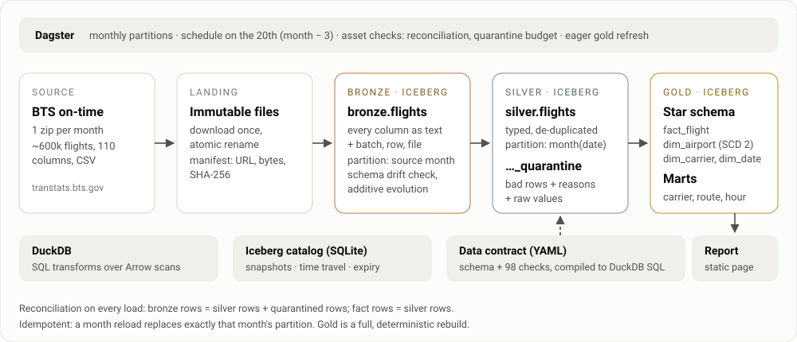

# open-lakehouse

A medallion lakehouse (bronze, silver, gold) built only from open tools: **Apache Iceberg** tables,
**DuckDB** for SQL, **Dagster** for orchestration and a **YAML data contract** that generates the
silver schema and its quality checks. It runs on a laptop with one command, and loads public data:
every scheduled US domestic flight from the Bureau of Transportation Statistics (BTS).

**[See the report it builds →](https://sidantap.github.io/portfolio-redesign/lakehouse/)**
3.4 million flights, January to June 2025, downloaded and loaded in about two minutes.



The point isn't the flight data. It's the patterns a production lakehouse needs, built without a
vendor platform, so each one is visible in a few hundred lines:

| Pattern | Where |
|---|---|
| Immutable landing zone with checksums and lineage | [`landing.py`](src/lakehouse/landing.py) |
| Idempotent, partition-scoped loads: re-running a month replaces exactly that month | [`bronze.py`](src/lakehouse/bronze.py), [`silver.py`](src/lakehouse/silver.py) |
| Schema-drift detection, and additive schema evolution with Iceberg | [`bronze.py`](src/lakehouse/bronze.py), [`catalog.py`](src/lakehouse/catalog.py) |
| A data contract compiled to SQL: types, required fields, ranges, patterns, cross-column rules, primary key | [`silver_flights.yml`](src/lakehouse/contracts/silver_flights.yml), [`contract.py`](src/lakehouse/contract.py) |
| Quarantine instead of dropping rows, with the reason and the raw values | [`silver.py`](src/lakehouse/silver.py) |
| Reconciliation on every load, and a quarantine budget that stops bad months | [`silver.py`](src/lakehouse/silver.py), [`gold.py`](src/lakehouse/gold.py) |
| Star schema with a Slowly Changing Dimension Type 2, built with gaps-and-islands SQL | [`dim_airport.sql`](src/lakehouse/sql/gold/dim_airport.sql) |
| Snapshots, time travel and snapshot expiry | [`cli.py`](src/lakehouse/cli.py) |
| Partitioned software-defined assets, asset checks and a schedule | [`definitions.py`](src/lakehouse/definitions.py) |

## Run it

With [uv](https://docs.astral.sh/uv/):

```bash
uv sync
uv run lakehouse run --months 2025-01:2025-03   # downloads ~80 MB from BTS, about a minute
uv run lakehouse report --out site               # open site/index.html
```

Or with Docker, which starts the Dagster UI at http://localhost:3000:

```bash
docker compose up
docker compose run --rm lakehouse lakehouse run --months 2025-01:2025-03
```

Everything lives in `./lakehouse_data` (set `LAKEHOUSE_HOME` to move it): the landed zips,
the Iceberg warehouse of Parquet and metadata files, and the SQLite catalog. Delete the folder to start over.

## A tour

```text
$ lakehouse run --months 2025-01:2025-06
2025-01:   539,747 bronze    539,747 silver       0 quarantined (0.000%)
2025-02:   504,884 bronze    504,884 silver       0 quarantined (0.000%)
2025-03:   600,872 bronze    600,871 silver       1 quarantined (0.000%)
2025-04:   583,950 bronze    583,950 silver       0 quarantined (0.000%)
2025-05:   605,648 bronze    605,648 silver       0 quarantined (0.000%)
2025-06:   611,575 bronze    611,575 silver       0 quarantined (0.000%)
gold: dim_airport 346, dim_carrier 14, dim_date 181, fact_flight 3,446,675, ...
```

The one quarantined row is a real error in the government data. The contract caught it and recorded why:

```text
$ lakehouse quarantine
│ 2025-03 │ max:crs_elapsed_min │ 1 │
{"FlightDate":"2025-03-30", "Reporting_Airline":"OH", "Origin":"CLT", "Dest":"TYS",
 "CRSDepTime":"2249", "CRSArrTime":"2359", "CRSElapsedTime":"1510.00", "Distance":"177.00", ...}
```

A 177-mile flight from Charlotte to Knoxville, scheduled 22:49 to 23:59, listed as taking
1,510 minutes (25 hours). It stays out of silver and every number built on it, and it's kept with
its raw values for anyone who wants to fix or replay it.

Every load is a snapshot, and any snapshot can be queried:

```text
$ lakehouse history silver.flights
 256461934114983271  2026-11-11 03:52:52  append  month=2025-02  +504884  -0  total=1044631
5252249241125026134  2026-11-11 03:53:11  append  month=2025-03  +600871  -0  total=1645502
...
$ lakehouse sql "SELECT count(*) FROM silver_flights" --at silver.flights=256461934114983271
│ 1044631 │          <- the table as it was after February loaded
```

`lakehouse tables`, `lakehouse sql "<any DuckDB SQL>"` and `lakehouse maintain --keep 5`
(expire old snapshots) cover the rest.

## Design decisions

**Bronze keeps everything as text.** Typing happens once, in silver, under the contract, where a
failure can be quarantined with a reason. Bronze only refuses a *file*, when its header lacks a
column the contract needs: loading it would just fail later and less clearly. New source columns
are welcome: the bronze table's schema evolves (union by name) and old snapshots stay readable.

**The contract is the schema.** [`silver_flights.yml`](src/lakehouse/contracts/silver_flights.yml)
declares each silver column's source, type and constraints, plus cross-column rules such as
*"when BTS reports delay causes, they add up to the minutes the flight arrived late"*.
[`contract.py`](src/lakehouse/contract.py) compiles it to one DuckDB query that types every
column and returns, for every row, the list of checks it failed. The docs, the schema and the checks
can't drift apart because they're the same file.

**Nothing disappears silently.** Every month must reconcile: bronze rows = silver rows + quarantined
rows, and gold's fact table must equal silver. If more than 0.5% of a month fails the contract,
the load stops before writing anything: that's an upstream change for a person to look at, not
something to quietly filter.

**Loads are idempotent and partition-scoped.** Each month overwrites exactly its own partition in one
Iceberg transaction, so re-running a month, or loading months out of order, gives the same tables.
(PyIceberg records an overwrite as a delete snapshot plus an append snapshot, committed together;
readers never see the table in between.)

**Gold is a full rebuild.** Bronze and silver load incrementally; gold is rebuilt from silver every
run. DuckDB does 3.4 million rows in about four seconds, and a full rebuild can never leave a stale
aggregate or dangling dimension key after a backfill.

**SCD Type 2 from history, not MERGE.** BTS gives each airport a stable ID, but its code, city name
and state can change. `dim_airport` turns the sightings in silver into versions with
`valid_from` / `valid_to` using gaps-and-islands SQL, and the fact table joins each flight to the
version valid on its date. Rebuilding from history keeps it right when an older month arrives late;
the tests load months out of order and expect identical versions, including an A → B → A rename
becoming three versions, not two.

**The catalog is swappable.** A SQLite catalog keeps it laptop-sized. Production would point
[`catalog.py`](src/lakehouse/catalog.py) at a REST, Glue or Nessie catalog and object storage;
nothing else changes, and the same tables can be read by Spark, Trino or Snowflake.

## Tests

`uv run pytest` runs 35 tests in about 20 seconds, with no network: they build small files in the
real BTS layout from made-up flights.

- every kind of contract violation is caught and named (16 cases), duplicates keep the first row,
  and midnight written as `2400` lands on the next day
- a month over the quarantine budget fails and writes nothing
- reloading a month replaces it; other months are untouched
- time travel returns the earlier data after a reload
- a missing source column is schema drift; a new one evolves the bronze schema
- SCD Type 2 versions are correct in order and when backfilled
- gold reconciles with silver, and a broken fact query fails loudly
- the report embeds the gold numbers and the quarantined rows
- the Dagster assets materialize, and their checks pass

CI runs lint, the tests and a Docker build on every push.

## Data

[BTS Reporting Carrier On-Time Performance (1987–present)](https://www.transtats.bts.gov/),
public domain. One zip per month, published about three months after the month ends; the Dagster
schedule loads month − 3 on the 20th. Carrier names come from [`seeds/carriers.csv`](src/lakehouse/seeds/carriers.csv);
an unknown code still loads, as "Unknown carrier".

MIT licensed.
